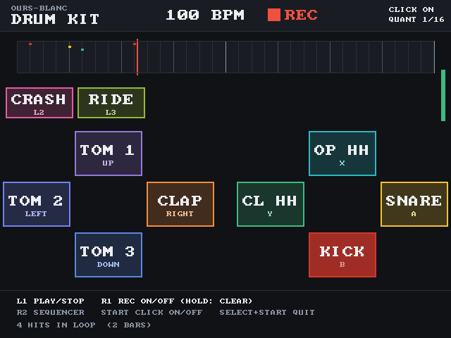
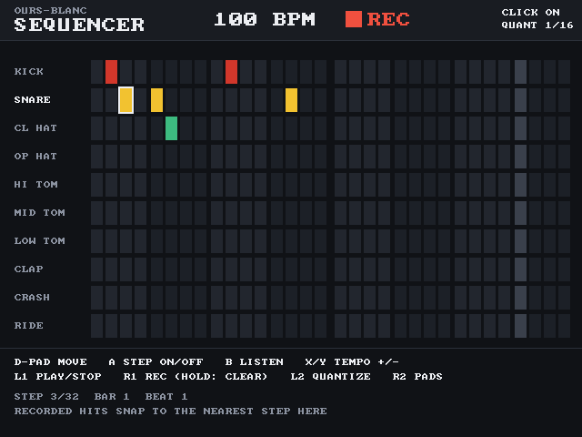

# ours-blanc Drum Kit

携帯ゲーム機 R36S（ArkOS・dArkOS 系）で動くドラムキット。RetroArch のコア（libretro, C）として作っていて、メニューの「Ports」から起動する。音はすべてプログラムで合成（サンプル音源なし）。

| パッド | シーケンサー |
|---|---|
|  |  |

## ボタン
| ボタン | 音 / 機能 |
|---|---|
| B / A | キック / スネア |
| Y / X | クローズドハット / オープンハット（クローズでオープンを止める） |
| 十字キー 上・左・下 / 右 | タム 1〜3 / クラップ |
| L2 / L3 | クラッシュ / ライド |
| L1 | 再生 / 停止 |
| R1 | ループ録音 ON/OFF（0.6 秒長押しでループをクリア） |
| R2 | ステップシーケンサー ⇄ パッド |
| START | メトロノーム ON/OFF |
| SELECT + START | 終了（RetroArch） |

シーケンサー：十字キーでカーソル、A でステップ ON/OFF、B で試聴、X/Y でテンポ ±1、L2 で録音のクオンタイズ ON/OFF。

ループは 4/4 拍子・2 小節（96 PPQ）。手で録音したフレーズとシーケンサーは同じイベント列を共有し、RetroArch のセーブフォルダに `ours-blanc-drumkit.dat` として自動保存する。録音は既定で 16 分音符にクオンタイズ。

## R36S に入れる
1. `make package` で `dist/r36s-drumkit.zip` を作る（またはリリースの zip）
2. 展開して `ports` の中身を SD カードの `EASYROMS/ports/` へ
3. メニュー →「Ports」→「Drum Kit」。起動の記録は `EASYROMS/ports/drumkit/log.txt`

## 開発
```sh
sudo apt install gcc-aarch64-linux-gnu zip
make            # dist/drumkit_libretro.so（aarch64、glibc 2.29 以上）
make test       # PC 用にビルドし、ボタン操作を再現して音とタイミングを検査
make package    # dist/r36s-drumkit.zip
```
`test/front.c` はボタン操作の台本を受け取って画面（PPM）と音（raw）を書き出す最小の libretro フロントエンド、`test/run_tests.py` がそれを使って、10 音すべての発音と遅延、ループ録音の再生位置、R1 長押しのクリア、メトロノーム間隔、シーケンサー、保存を確かめる。
