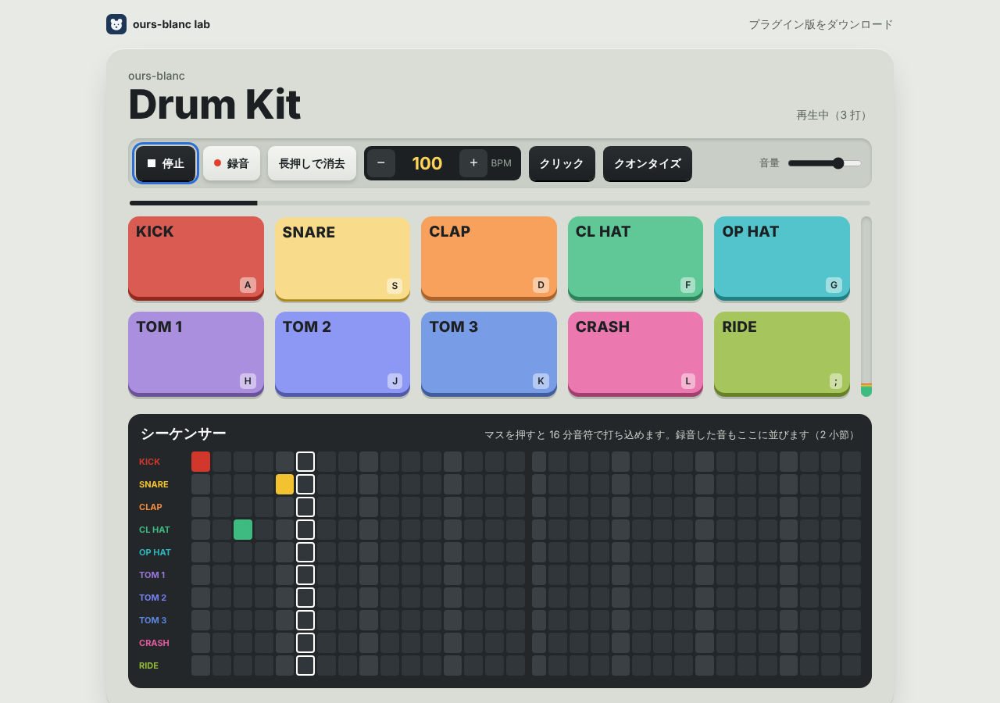
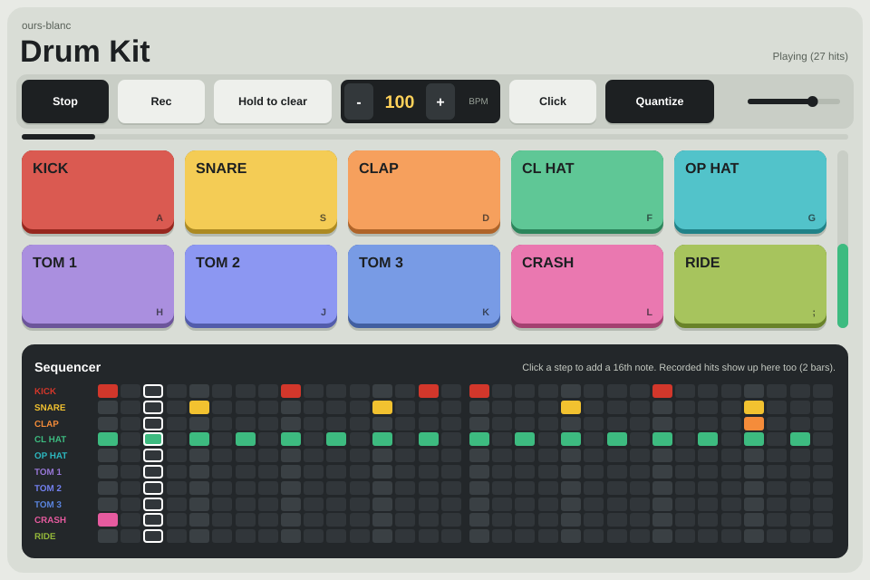

# ours-blanc Drum Kit

10 種類のドラム、2 小節のループ録音、32 ステップのシーケンサー。音はすべてプログラムで合成（サンプル音源なし）。同じ C のエンジンを 3 つの形で動かしている。

| 形 | 中身 | 入手 |
|---|---|---|
| Web 版 | エンジンを WebAssembly にして AudioWorklet で鳴らす | https://ours-blanc.app/lab/drumkit/ |
| Mac / Windows | JUCE のスタンドアローン + VST3 / AU（Mac）、VST3（Windows） | 同じページ、または Releases |
| R36S | RetroArch のコア（libretro）。メニューの「Ports」から起動 | 同じページ、または Releases |

すべて無料。

| Web 版 | プラグイン版 |
|---|---|
|  |  |

## 構成
```
engine/          共通エンジン（C、入出力なし）: 合成、ボイス、ループ、録音とクオンタイズ、シーケンサー、DAW 同期、保存形式
src/drumkit.c    R36S 用 libretro コア（画面とボタン）
web/             Web 版（index.html, app.js, worklet.js, wasm_api.c）
plugin/          JUCE のプロセッサとエディター
installer/       Mac の .pkg、Windows の Inno Setup
test/            エンジン、R36S コア、プラグインのテスト
```

## プラグイン版
- MIDI ノートで鳴らせる（General MIDI のドラム配置: 36 キック、38 スネア、42 / 46 ハット、50 / 47 / 43 タム、39 クラップ、49 クラッシュ、51 ライド ほか）。ベロシティ対応
- DAW が再生中は DAW のテンポと再生位置にループとシーケンサーが合う。停止中はプラグインの再生ボタンで単独に動く
- パターンと音量は DAW のプロジェクトに保存される
- DAW の中ではクリックは既定でオフ（スタンドアローンではオン）

## R36S のボタン
| ボタン | 音 / 機能 |
|---|---|
| B / A | キック / スネア |
| Y / X | クローズドハット / オープンハット（クローズでオープンを止める） |
| 十字キー 上・左・下 / 右 | タム 1〜3 / クラップ |
| L2 / L3 | クラッシュ / ライド |
| L1 | 再生 / 停止 |
| R1 | ループ録音 ON/OFF（0.6 秒長押しでループをクリア） |
| R2 | ステップシーケンサー ⇄ パッド |
| START | メトロノーム ON/OFF |
| SELECT + START | 終了（RetroArch） |

シーケンサー：十字キーでカーソル、A でステップ ON/OFF、B で試聴、X/Y でテンポ ±1、L2 で録音のクオンタイズ ON/OFF。パターンは RetroArch のセーブフォルダに `ours-blanc-drumkit.dat` として自動保存する。

R36S に入れる：zip を展開して `ports` の中身を SD カードの `EASYROMS/ports/` へ。起動の記録は `EASYROMS/ports/drumkit/log.txt`。

## 開発
```sh
# R36S コアと Web 版
sudo apt install gcc-aarch64-linux-gnu zip && pip install ziglang
make test       # エンジンのテスト + PC 用コアでボタン操作を再現して音とタイミングを検査
make package    # dist/r36s-drumkit.zip（aarch64、glibc 2.29 以上）
make web        # dist/web/（エンジンを WebAssembly に）

# プラグイン（JUCE 8 は CMake が取得）
cmake -B build-plugin -DCMAKE_BUILD_TYPE=Release
cmake --build build-plugin --config Release
ctest --test-dir build-plugin -C Release   # エンジン + プラグインのテスト（MIDI のタイミング、DAW 同期、状態の保存）
```
GitHub Actions（`.github/workflows/build.yml`）が Mac（Apple Silicon / Intel）と Windows でビルドし、pluginval で検査して、`.pkg` と `.exe` を作る。main へのプッシュで Releases に置く。Mac の署名と公証は、リポジトリのシークレット（`MAC_APP_IDENTITY` など）があるときだけ行う。
